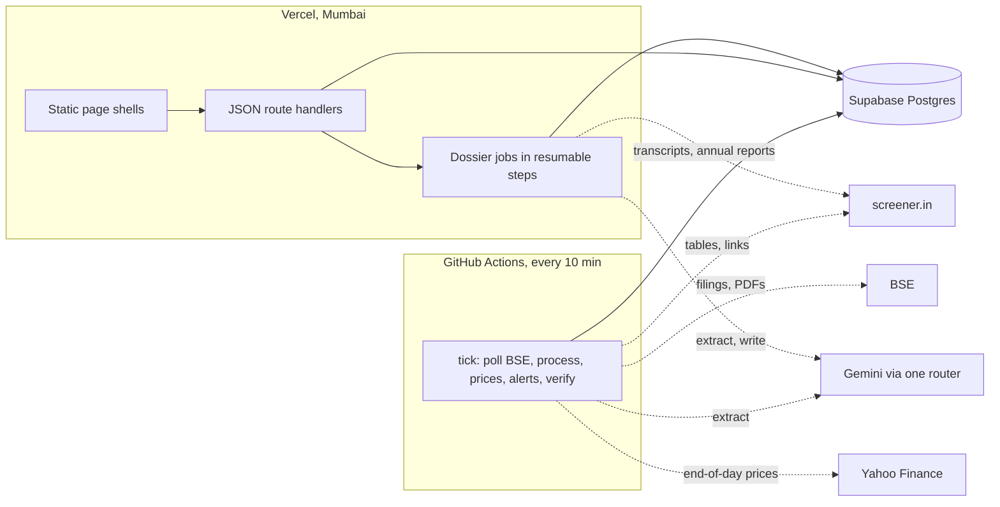

# FINN: a financial investment agent that tells you what to stop reading

FINN watches an Indian equity portfolio and gives the investor two things:

- **The Brief (push):** every filing across 18 holdings, grouped into events, ranked by a
  materiality score with its reasons, and finished: Top items as cards, the next tier as
  single lines, the routine collapsed into one row and the paperwork only counted.
  Results get a first cut of Revenue, EBITDA, PBT and PAT against last quarter and last year,
  read from the filing's own statement page and checked arithmetically. Management changes
  get a person card with a sourced background. Price and volume alerts say which filing,
  if any, explains the move.
- **The Dossier (pull):** for any NSE company, a Say-vs-Do ledger of what management
  promised on its last five calls against what the numbers then showed, plus the financial
  snapshot, cash quality, balance sheet and a cited bull and bear case. Built only from the
  company's call transcripts, annual report and standardised financial tables.

**Try it on a phone: [enam-holdings-assgn.vercel.app](https://enam-holdings-assgn.vercel.app)**

AI build history: [`BUILD_LOG.md`](BUILD_LOG.md) and the conversation linked in the submission email.

## Try it in two minutes

1. Open the app. The Brief opens on the last 24 hours with its funnel line:
   *filings → events → what matters*. Switch to **7d** for a busier window.
2. Tap a results card, then **Open filing p.N**: the PDF opens on the page the numbers came
   from. The sheet behind each card shows the six checks and the exchange cross-check.
3. Open **Alerts → Watch rules** and type *"Tell me if SUZLON moves 5%"*. FINN turns it into
   a rule chip that code evaluates after every run.
4. Go to **Research**, type any NSE symbol (try TITAN or HCLTECH) and watch the dossier
   build. Every bullet has a source chip that opens the page or table cell behind it.

Every visitor gets their own copy of the demo portfolio and rules (an anonymous cookie, no login).

## How FINN decides

```
score = base(kind of event)
      + 15 governance red flag (unplanned CEO/CFO/auditor exit, downgrade, new pledge)
      + deal size: +15 at ≥10% of market value, +5 at ≥5%, −15 below 2%, −45 below 0.5%
        (orders against annual revenue instead)
      + 10 when the stock then moved past the alert thresholds
      + 5 / 10 when the holding is 5% / 10% of the portfolio
      × feedback (Not useful 0.7, muted category 0.3)
Top ≥ 70 · Worth a look 40–69 · Routine 15–39 (collapsed) · Hidden < 15 (counted)
```

| Event | Base | What FINN shows |
| --- | --- | --- |
| Results | 90 | Card: four numbers, QoQ and YoY, margin in bps, checks, verified badge |
| Auditor resigns / CEO, CFO, MD change | 95 / 85 | Person card with background and red flags |
| Acquisition, merger | 80 | One line sized against market value |
| Equity raise, buyback | 75, 70 | One line with the amount |
| Rating downgrade / new pledge | 75 / 70 | Flagged |
| Order win | 50 | One line sized against annual revenue |
| Analyst meets, trading windows, certificates | 5–15 | Counted, not shown |

On a captured sample of 224 real BSE filings, ordered rules placed 201 with no
model call; generic "Disclosure under Regulation 30" letters are then read from the letter
itself (its "Sub:" line and first sentences), which placed 15 more, and the results-day
context 3 more; on the live run that is **242 of 247 filings (98%) classified without a model**. Deals are
sized against market value and orders against revenue, so a ₹50 crore startup stake at a
₹1 lakh crore company stays routine; amounts that are not the story (the bank lines behind a
rating action) never move a score. One letter filed under three exchange subcategories, a
results day's six filings, or an IPO's run of updates each count once.

## Architecture



- **Postgres is the only contract.** Screens read the JSON API, the API reads Postgres; no
  page load calls a model or a scraper, so a slow source never blanks the app.
- **GitHub Actions is the worker and the clock.** It runs the same pipeline code as the app
  (`scripts/finn.ts tick`), every stage idempotent and leased, so a late or doubled run is harmless.
  GitHub's scheduler is best effort, so there is a second clock: when the pipeline has been
  quiet for 15 minutes, the next visit runs a tick on Vercel in the background.
- **The Brief is server-rendered with its data** (partial prerendering: a static shell, the
  Brief streamed in the same response), so the first paint shows the cards, not a spinner.
- **Dossier builds run on Vercel** in resumable steps under a lease; the client's progress
  poll keeps a build moving within the 300-second function limit.
- **Push without secrets handling:** Web Push VAPID keys are generated into the database
  on first use, so no one copies a private key around.

## Data and the primary-source rule

| Source | Used for |
| --- | --- |
| BSE corporate announcements API and PDFs | Every filing; results and disclosure PDFs |
| BSE result calendar | Upcoming results |
| Yahoo Finance (`.NS`), BSE price history as fallback | End-of-day prices and volumes |
| screener.in | Standardised financial tables and links to transcripts and annual reports. Never its prose. |
| Google Search grounding (Gemini) | Only for a new executive's professional background, each fact with its link. Never LinkedIn. |

The Dossier uses only the company's own documents and tables: no broker notes, no news, and
the synthesis model never sees raw documents or its own memory of the company. Every bullet
must cite a page or a table cell, and every number in it must match one; bullets that fail
are dropped and counted on the page.

## Models and cost

| Work | Model tier | Why |
| --- | --- | --- |
| Classify ambiguous filings (≈10%), one-liners, draft watch rules | Flash-Lite, batches of 25 | Short text, high volume |
| Read a results statement page, a disclosure, a transcript | Flash | Structured extraction from 1–2 targeted pages or one document |
| Person background | Flash with Google Search grounding | Needs sources |
| Dossier summary | Newest Flash, high thinking | One call per dossier, from compact JSON |

Everything runs on free tiers. Every call is logged with tokens and a paid-rate estimate,
and cached by content hash; the in-app **Cost** page shows calls, cache hits and spend.

## Quality

Measured on the deployed app with live data (October 2026):

| Check | Result |
| --- | --- |
| Filings classified without a model | 242 of 247 (98%) |
| Results numbers matching screener's quarterly table | 87 of 98 within 0.5% (88.8%) across 10 results; the misses are EBITDA definitions (L&T's financial-services finance cost, KPIT), not misreads |
| Results arithmetic checks passing | every card shows its six checks; a failed check is shown, not hidden |
| Lighthouse, mobile, on the Brief (three runs) | 94–97 performance, 100 accessibility, 100 best practices, 100 SEO |
| Console errors and failed requests across 14 screens, light and dark | 0 |
| Model calls for the whole run | 433 (counting retries and free-tier refusals), about $0.98 at paid rates, ₹0 spent |
| 30-day Brief, 18 holdings | 241 filings became 63 events, 28 worth reading |
| Say vs Do on L&T | 2 of 3 resolved promises met (67%): FY26 order inflow +20% against ≥10%, working capital 4.1% against 10%; FY26 revenue +11.8% against 15% missed |

How it is kept honest:

- **LLMs extract, code decides, and code checks the extraction.** In the live run the
  cheapest model copied the prompt's "FY27" into every FY26 promise and left "Rs 1,356
  billion" as 1,356 crore. `src/lib/research/normalize.ts` now re-derives each promise's
  period from its own quote ("FY '26", "by March '26", "full year" in a Q2 call), the call's
  year words, or a heading on the page; converts money from the speaker's words; refiles
  metrics the words do not support (working capital is not net debt); checks a segment's
  target (L&T's P&M margin, Polycab's FMEG) against what management reports for it, never
  the consolidated tables; and drops analysts restating guidance and numbers not in the quote.
- **149 automated tests**, most on real data: classification on real BSE subjects and
  disclosure letters, results-page finding on real scanned text layers, results maths and the
  six checks on L&T's real Q2 FY27 numbers, grouping of real repeat filings, person-card rules
  on real Info Edge, KPIT and HAL filings, 29 ledger checks on real quotes from L&T, Infosys,
  Bajaj Finance, Eternal and Polycab calls, the screener parser on a real page, lender facts,
  and two end-to-end runs on real Postgres (PGlite) with real PDFs and model stand-ins.
- **Replays against production data:** `scripts/finn.ts dump` (a workflow) exports the
  research inputs and the last two weeks of filings to a branch; `scripts/dev/ledger-replay.ts`
  and `scripts/dev/replay.ts` rebuild the ledger and the Brief from them offline.
- **Runtime guards:** arithmetic checks with one corrective retry on every results card;
  quote-on-page checks on every extracted fact; a cross-check against screener's quarterly
  row a few hours later; citation and number checks on every dossier bullet.

## Left out, on purpose

Intraday prices, broker estimates and news (secondary data), login, a native app and P&L
tracking. NSE's feed is optional (BSE carries the same filings and is reliable from cloud hosts).

## Running it

```bash
npm ci
cp .env.example .env.local        # DATABASE_URL, GEMINI_API_KEY
npx tsx scripts/finn.ts migrate && npx tsx scripts/finn.ts seed
npx tsx scripts/finn.ts backfill && npx tsx scripts/finn.ts process
npm run dev
```

Tests: `npx vitest run`. A synthetic local preview with no network: `npx tsx scripts/dev/preview-db.ts`.

FINN is a research prototype, not investment advice.
